# Temperature & Humidity Logger: Red Cross Cooling Shelter

A battery-powered Arduino Nano + Sensirion SHT41 data logger built to validate a rapidly deployable emergency cooling shelter for 20 people. Built for the International Red Cross as part of my UT Austin Mechanical Engineering senior capstone (Spring 2026), and field-tested at UT's Brackenridge Field Lab.

One logger sat inside the shelter and one outside (under shade), recording temperature and humidity every ~3 seconds across three full-day tests: no cooling, fans, and a rented A/C unit.

  
  &nbsp;
  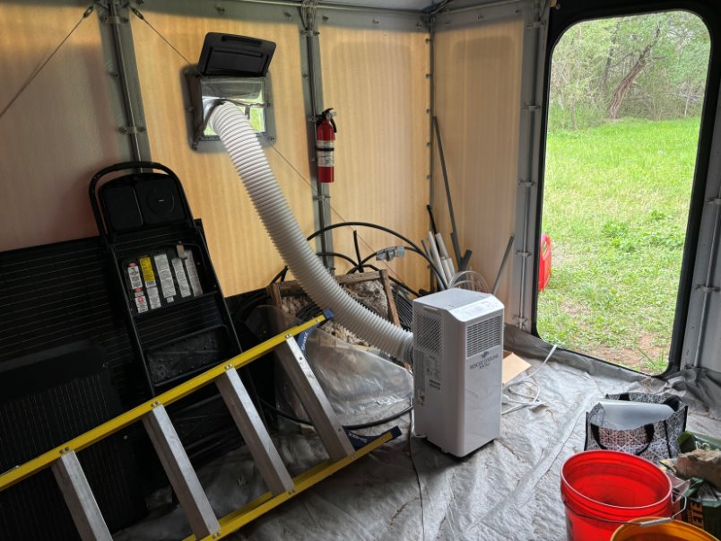

<em>Left: Data Logger || Right: A/C unit inside the 188 sq ft field shelter.</em>

---

## Results at a glance

| Test day | Cooling | Result (inside vs. outside, wet-bulb) |
|---|---|---|
| 1 | None (control) | Inside peaked at ≈24.8 °C, ≈3 °C above outside. Dry-bulb ran ≈7 °C hotter inside. |
| 2 | 2 fans at wall vents | Inside held within ≈0.5 °C of outside until a power failure at ~11:00, then climbed ≈2 °C above. |
| 3 | 6,000 BTU portable A/C + gas generator | Inside never exceeded ≈22.8 °C, under the 25 °C safety limit all day. Switching to high fan speed widened the gap to ≈2–3 °C below outside. |

**Pass criteria:** inside wet-bulb temperature ≤ 25 °C, and a consistent reduction relative to outside. The A/C configuration, which matches the final design, met both.

  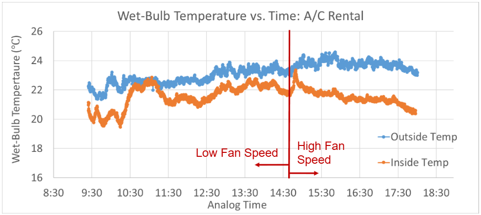

---

## Test setup (Prototyping)

- **Shelter:** 188 sq ft humanitarian shelter at the Brackenridge Field Lab. Cooling scales by ~7× from this test to the full design, while floor area scales by ~5×, so the test is conservative.
- **Instrumentation:** two identical loggers, one inside the shelter and one outside.
- **Schedule:** three test days with similar forecast conditions (mostly cloudy, high near 31 °C), one cooling method per day.
- **Wet-bulb temperature:** computed in post-processing from logged temperature and relative humidity. Wet-bulb accounts for the effects of humidity on the body's abiity to cool itself.
<!-- TODO: name the wet-bulb formula you used (e.g., Stull 2011) and how the inside/outside logs were time-aligned. -->

<!-- TODO: upload fig05a_fans_mounted_at_vents.jpg and fig05b_fan_mount_closeup.jpg to Images/, then delete these comment markers to show them.

  
  &nbsp;
  

<em>Fan mounts: 3D-printed brackets and laser-cut plywood shelves, fixed to the wall using the shelter's original fasteners.</em>

-->

### Day 1: No cooling (control)

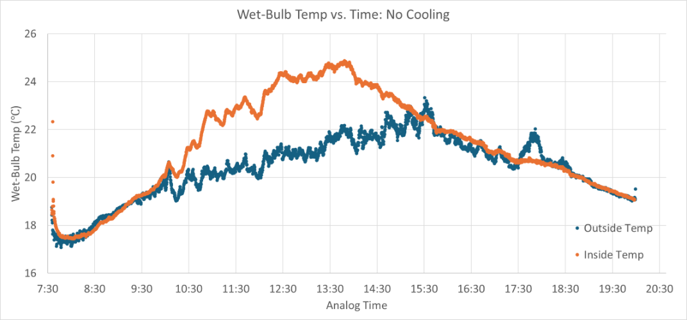

With minimal ventilation, the closed shelter acts as a heat trap. This result is the baseline the other two days are compared to.

### Day 2: Fans

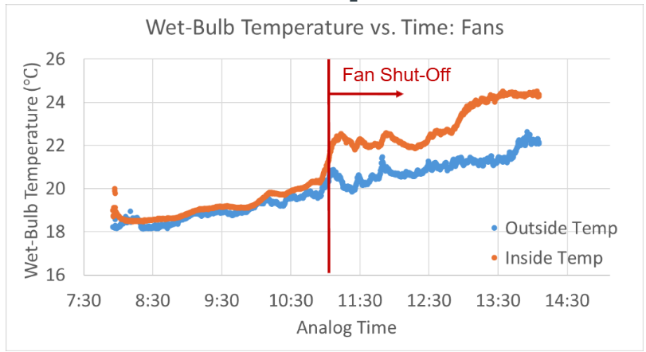

Two Vornado fans pulling air through the wall vents kept the inside matched to outside conditions until the battery supply failed. When the fans' battery supply failed at ~11:00, the inside dry-bulb temperature rose ≈5 °C in about 15 minutes.

### Day 3: Rented A/C

The unit ran at low fan speed until a refuel stop at ~14:40 and at high fan speed afterward. The inside-outside gap widened noticeably after the switch, as seen in the chart under *Results at a glance*.

---

## Learnings

1. **Airflow mattered almost to the same degree as cooling capacity.** The same A/C unit produced a much larger temperature reduction on high fan speed than on low.
2. **Cooling has to be continuous.** The unplanned fan outage on Day 2 and the generator shutdown during the Day 3 refuel both caused immediate temperature spikes, due to the poor insulation of the shelter (which is similar to the "real" shelter). Power continuity is required. 

---

## Hardware

| Component | Role |
|---|---|
| Arduino Nano v3 | Microcontroller |
| Sensirion SHT41 | Temperature (±0.2 °C) and humidity (±1.8 % RH) sensor, I²C |
| microSD card module | Data storage, SPI |
| Battery pack | Supplies 5 V to the Nano's +5V pin, for field operation with no grid power |

**Wiring**

| From | To (Nano) |
|---|---|
| SHT41 VDD / GND | 3V3 / GND |
| SHT41 SDA / SCL | A4 / A5 |
| microSD VCC / GND | +5V / GND |
| microSD CS / MOSI / MISO / SCK | D10 / D11 / D12 / D13 |
| Battery + | +5V |

  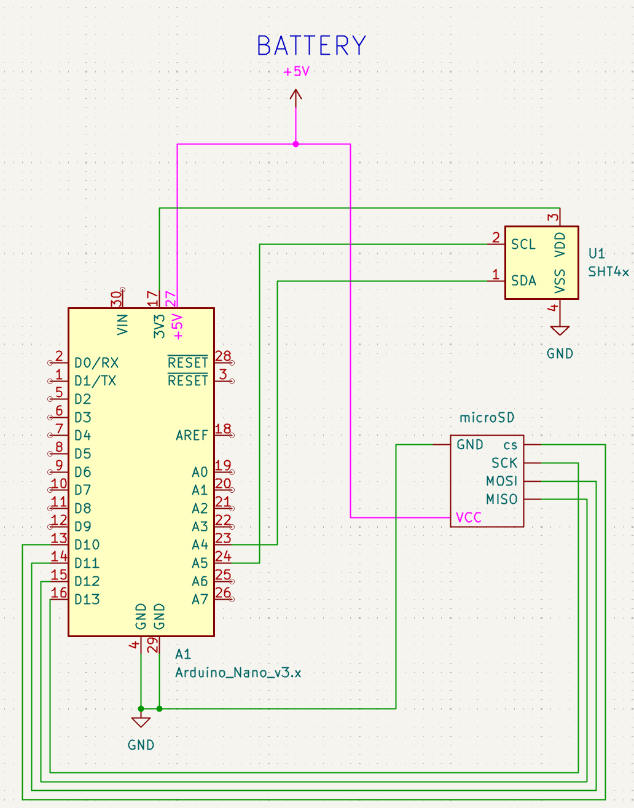

The editable KiCad schematic is in `Temperature Sensor.kicad_sch`.

---

## Firmware (`SHT41_Code.ino`)

- **Sampling:** a non-blocking `millis()` timer samples every ~3 s. The SHT41 runs in high-precision mode with its heater off.
- **Logging:** each reading is appended to `LOG.csv` on the SD card as `Time (ms), Temperature (C), Humidity (%)`. A header row is written if the file doesn't exist yet. The file is opened and closed on every write, so a sudden power loss costs at most one sample.
- **Fault codes:** the logger runs headless in the field, so it reports startup faults through the onboard LED:
  - 2 slow blinks: sensor not found. The logger halts.
  - 4 fast blinks: SD card failed to initialize.

**To run it:**

1. Install the **Adafruit SHT4x** library from the Arduino Library Manager. `SD` and `SPI` come with the Arduino IDE.
2. Flash `SHT41_Code.ino` to the Nano.
3. Insert a FAT32-formatted microSD card and turn on.
4. Optionally, confirm readings in the Serial Monitor.

---

## Known limitations & next steps

- **No wall-clock time.** Timestamps are milliseconds since power-on, so aligning the inside and outside logs depends on starting both loggers together. This could be fixed by adding a real-time clock to each logger.
- **Silent data loss on SD failure.** If the SD card fails at startup, the loop keeps sampling without saving anything. Fixes: halt or retry, and keep a persistent fault LED on.
- **Full-scale validation.** The next step for the project would be testing the full design: inflatable tent, commercial A/C, and diesel generator. (This was prohibitively expensive for a student project unfortunately) 

---

## Repository contents

| Path | Description |
|---|---|
| `SHT41_Code.ino` | Field firmware (current) |
| `Temperature Sensor.kicad_sch`, `.kicad_pro` | KiCad schematic and project |
| `Images/` | Photos and result plots |
| `Data/` | Contains raw and modified Csv data from the temperature sensors
| `Sensorode.ino` | Earlier prototype using a DHT11 sensor, adapted from an Elegoo tutorial |
| `dht_nonblocking.*`, `keywords.txt`, `library.properties` | Bundled [DHT_nonblocking](https://github.com/olewolf/DHT_nonblocking) library by Ole Wolf (GPL-3.0), used only by the DHT11 prototype |

---

## Project context

The capstone delivered a shelter design for Red Cross branches to use in heat emergencies: an off-the-shelf inflatable tent with 20 cots and medical access aisles. A commercial A/C unit and diesel generator sit outside the tent under a canopy, keeping noise and fumes away from occupants. The system deploys in under 2 hours with a 4-person team, at an estimated cost of about $47,000 per station.

**My role:** I designed and built the data acquisition system, and designed, ran, and analyzed the field tests.

Thanks to our sponsor, Mr. William Carter, and to Prof. Bailey Jones for access to the Brackenridge Field Lab.

---

<strong>Raw temperature and humidity plots</strong>

 

**No cooling**
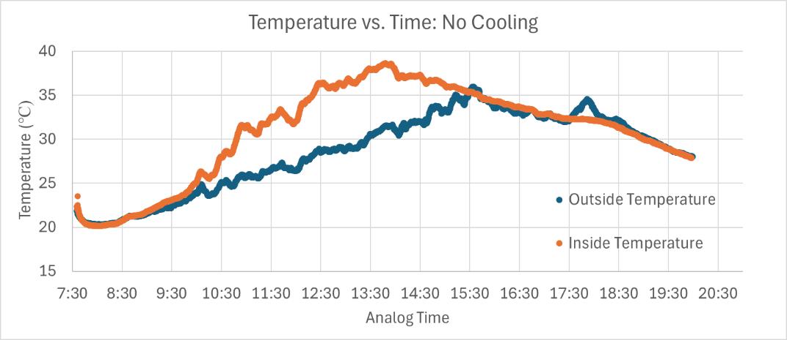
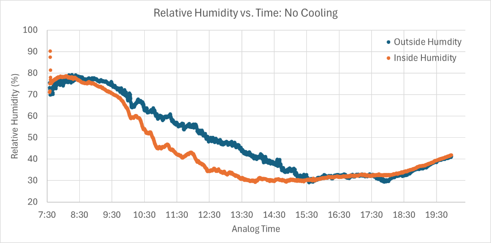

**Fans**
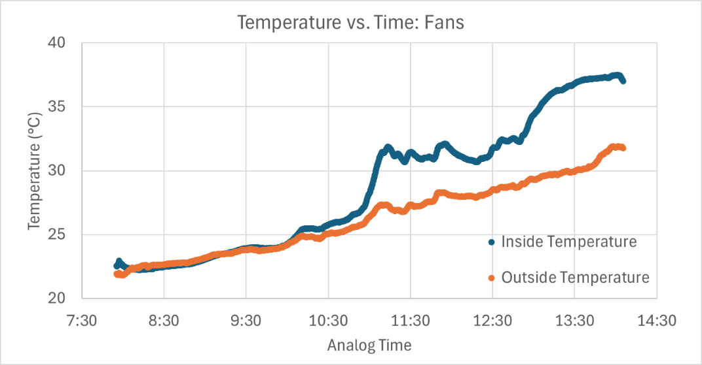
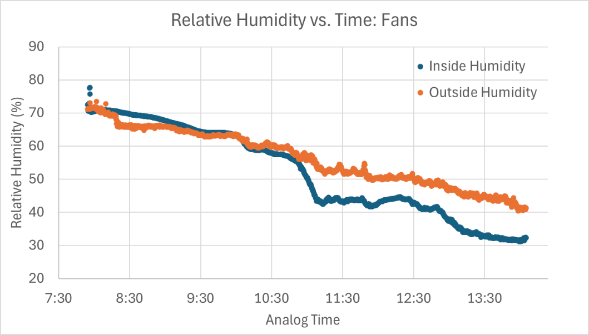

**A/C rental**
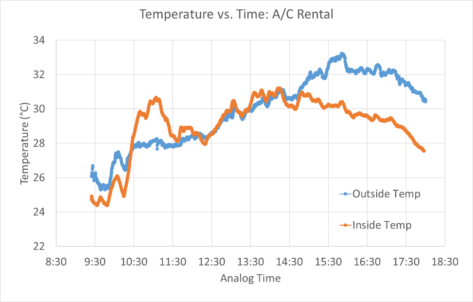
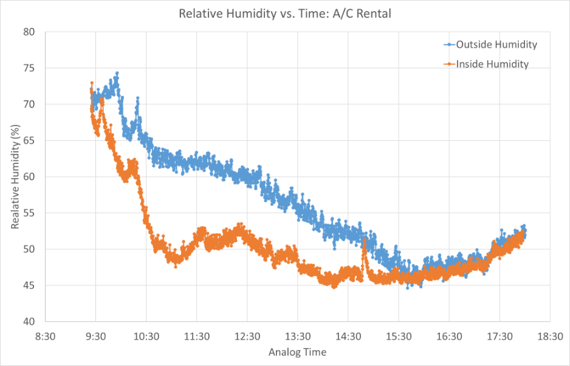

